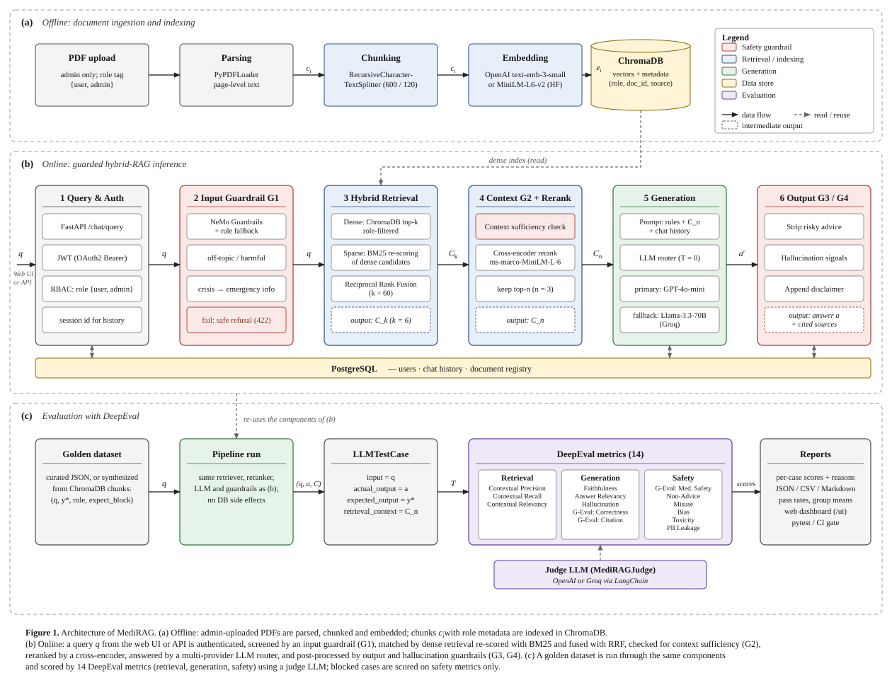

<div align="center">

# 🏥 RAG Medical Assistant

### Production-Grade Medical RAG · Multi-Model · Hybrid Search · Guardrails

[](https://python.org)
[](https://fastapi.tiangolo.com)
[](https://langchain.com)
[](LICENSE)

> Upload medical PDFs → Ask questions → Get cited, safe, role-restricted answers.
> Built for production with multi-model LLM, hybrid search, reranking, and 4-layer medical guardrails.

</div>

---

## 📋 Table of Contents
- [Overview](#-overview)
- [Architecture](#-architecture)
- [Key Features](#-key-features)
- [API Endpoints](#-api-endpoints)
- [Quick Start](#-quick-start)
- [Docker Deployment](#-docker-deployment)
- [Environment Variables](#-environment-variables)
- [Guardrails System](#-guardrails-system)
- [Project Structure](#-project-structure)

---

## 🔍 Overview

RAG Medical Assistant is a production-ready Retrieval-Augmented Generation system designed for medical knowledge bases. It allows organizations to upload medical PDFs and enable role-restricted Q&A with full source citation.

---

## 🏗️ Architecture



---

## ✨ Key Features

| Feature | Details |
|---|---|
| 🤖 Multi-model LLM | OpenAI gpt-4o-mini (primary) → Groq llama-3.3-70b (auto-fallback) |
| 🔍 Hybrid Search | Semantic (ChromaDB) + BM25 keyword + RRF fusion |
| 🎯 Reranking | Cross-encoder ms-marco-MiniLM — reduces hallucination |
| 🛡️ 4-Layer Guardrails | Input · Context · Output · Hallucination detection |
| 🔐 JWT Auth | OAuth2 Bearer tokens, role-based access (user/admin) |
| 💬 Chat History | Multi-turn memory per session stored in PostgreSQL |
| 📄 Role-based Docs | Documents tagged per role — users only see their docs |
| 🌍 Multi-embedding | OpenAI embeddings or HuggingFace (free, local) |
| 🐳 Docker-ready | Full stack: API + PostgreSQL in one `docker compose up` |

---

## 🌐 API Endpoints

| Method | Endpoint | Auth | Description |
|---|---|---|---|
| `GET` | `/` | — | API info |
| `GET` | `/api/v1/health` | — | Health + feature flags |
| `POST` | `/api/v1/auth/signup` | — | Register user |
| `POST` | `/api/v1/auth/login` | — | Login → JWT token |
| `POST` | `/api/v1/documents/upload` | Admin | Upload PDF |
| `GET` | `/api/v1/documents/list` | User | List accessible docs |
| `POST` | `/api/v1/chat/query` | User | Ask a medical question |
| `GET` | `/api/v1/chat/history/{session_id}` | User | Get chat history |

---

## ⚡ Quick Start

### Prerequisites
- Python 3.11+
- PostgreSQL (or use Docker)
- API keys: [OpenAI](https://platform.openai.com/api-keys) or [Groq](https://console.groq.com)

```bash
git clone https://github.com/MHanzala74/RAG-Medical-Assistant.git
cd RAG-Medical-Assistant

python -m venv .venv && source .venv/bin/activate
pip install -r requirements.txt

cp .env.example .env   # Fill in your API keys

make dev               # Start with auto-reload
```

API at **http://localhost:8000** · Docs at **http://localhost:8000/docs**

---

## 🐳 Docker Deployment

```bash
docker compose up --build        # API + PostgreSQL
docker compose up -d --build     # Background
docker compose logs -f api       # Follow logs
docker compose down              # Stop
```

---

## ⚙️ Environment Variables

| Variable | Required | Default | Description |
|---|---|---|---|
| `OPENAI_API_KEY` | ✅* | — | OpenAI key (*or Groq) |
| `GROQ_API_KEY` | ✅* | — | Groq key (fallback LLM) |
| `JWT_SECRET_KEY` | ✅ | — | Secret for JWT signing |
| `POSTGRES_PASSWORD` | ✅ | — | PostgreSQL password |
| `PRIMARY_LLM` | ⬜ | `openai` | `openai` or `groq` |
| `EMBEDDING_PROVIDER` | ⬜ | `openai` | `openai` or `huggingface` |
| `USE_HYBRID_SEARCH` | ⬜ | `true` | Enable BM25 + semantic fusion |
| `USE_RERANKER` | ⬜ | `true` | Enable cross-encoder reranking |
| `ENABLE_GUARDRAILS` | ⬜ | `true` | Enable 4-layer guardrails |
| `RETRIEVER_K` | ⬜ | `6` | Docs to retrieve before rerank |
| `RERANKER_TOP_N` | ⬜ | `3` | Docs sent to LLM after rerank |

---

## 🛡️ Guardrails System

```
Query
  │
  ▼
Layer 1 — INPUT GUARDRAIL
  · Off-topic blocking (non-medical queries)
  · Harmful content detection
  · Crisis / self-harm redirect to emergency services
  · Min-length validation
  │
  ▼  (PASS)
Layer 2 — CONTEXT GUARDRAIL
  · Checks if retrieved chunks are sufficient
  · Returns "not found" message instead of hallucinating
  │
  ▼  (PASS)
  [LLM generates answer]
  │
  ▼
Layer 3 — OUTPUT GUARDRAIL
  · Strips dangerous specific dosage instructions
  · Strips definitive diagnostic statements
  · Appends mandatory medical disclaimer
  │
  ▼
Layer 4 — HALLUCINATION CHECK
  · Detects fabrication signal phrases
  · Logs warning if detected
  │
  ▼
Final Response (safe, cited, disclaimed)
```

---

## 📁 Project Structure

```
RAG-Medical-Assistant/
├── app/
│   ├── api/
│   │   └── v1/
│   │       ├── __init__.py        # Router aggregator
│   │       ├── auth.py            # Signup, login (JWT)
│   │       ├── chat.py            # POST /chat/query, GET /chat/history
│   │       ├── documents.py       # POST /documents/upload, GET /list
│   │       └── health.py          # GET /health
│   ├── core/
│   │   ├── config.py              # Pydantic settings (all from .env)
│   │   └── security.py            # JWT create/decode, password hashing
│   ├── db/
│   │   ├── database.py            # psycopg2 connection pool
│   │   └── models.py              # Table creation + CRUD
│   ├── guardrails/
│   │   └── medical_guardrails.py  # 4-layer guardrail system
│   ├── rag/
│   │   ├── embeddings/
│   │   │   ├── base.py            # Abstract embedding interface
│   │   │   ├── openai_embeddings.py
│   │   │   ├── hf_embeddings.py   # HuggingFace (free, local)
│   │   │   └── router.py          # Provider selection
│   │   ├── retriever/
│   │   │   └── hybrid_retriever.py # Semantic + BM25 + RRF fusion
│   │   ├── reranker/
│   │   │   └── cross_encoder.py   # ms-marco-MiniLM reranker
│   │   ├── chain.py               # Full RAG pipeline
│   │   ├── ingestion.py           # PDF → chunks → ChromaDB
│   │   ├── llm_router.py          # OpenAI / Groq selection
│   │   └── vectorstore.py         # ChromaDB singleton
│   ├── schemas/
│   │   ├── auth.py                # SignupRequest, TokenResponse
│   │   ├── chat.py                # ChatRequest, ChatResponse, Source
│   │   └── docs.py                # UploadResponse, DocsListResponse
│   └── utils/
│       ├── logger.py              # Rotating file + console logger
│       └── exceptions.py          # RAGException, GuardrailException
├── docs/
│   └── architecture.svg           # System architecture diagram
├── docs_store/                    # Uploaded PDFs (gitignored)
├── chroma_db/                     # ChromaDB vector data (gitignored)
├── logs/                          # Application logs (gitignored)
├── main.py                        # FastAPI entry point
├── Makefile                       # Dev commands
├── Dockerfile                     # Multi-stage production image
├── docker-compose.yml             # API + PostgreSQL
├── requirements.txt
└── .env.example
```

---

<div align="center">
Built with ❤️ for medical AI research · LangChain · FastAPI · ChromaDB
</div>
